# Processor Atlas

Six original animated explanations of **CPU, GPU, TPU, NPU, LPU and DPU** architecture, designed for learning by Khaled Hassan.



## Open the interactive version

Download [dist/index.html](dist/index.html) and open it in a modern browser. It is a single self-contained file: no installation, account, API key, network connection or build step is required. GitHub's source viewer displays HTML code rather than running the application.

Select a processor and use **Play animation**, **Next step**, **Restart**, or the six step markers. Choose Slow, Normal or Fast playback. The GPU view also switches between Training and Inference. **Animate all six** runs the overview diagrams together for one cycle.

## What each animation explains

| Processor | Worked example | Mechanism |
| --- | --- | --- |
| CPU | Add 2 + 3 and return 5 | Fetch, decode, ALU execution, result storage and application return |
| GPU | Distribute work across compute tiles | Device memory, parallel kernels, reduction, gradients and weight updates; inference omits training updates |
| TPU | Multiply two 2 × 2 matrices | Staggered values and multiply-accumulate cells produce `[[19,22],[43,50]]` |
| NPU | Caption speech on a supported device | Model preparation, local input, runtime placement, supported inference and postprocessing |
| LPU | Generate an illustrative sentence | Ahead-of-serving compilation, on-chip memory, scheduled execution and token streaming |
| DPU | Allow one packet and drop another | Flow classification, configured policy, supported offloads and destination delivery |

Every processor has six explanatory steps, a worked example, use cases, limitations and links to technical documentation. The page also shows an illustrative architecture in which several processor types work together.

## Graphic exports

- [Static SVG infographic](dist/processor-atlas.svg): scalable original artwork for a document or presentation.
- [Animated SVG infographic](dist/processor-atlas-animated.svg): six synchronized explanations in an 18-second repeating cycle. Download and open in a browser; embedded preview behavior depends on the viewer.

The HTML explorer provides the detailed captions and playback controls. The SVG is the compact visual companion. No screenshot, vendor product photograph or artwork from the supplied reference has been reused.

## Technical accuracy and limitations

These are conceptual teaching models, not circuit layouts, hardware simulators or benchmarks. Animation durations do not imply relative processor performance. The displayed examples use simplified scheduling, memory and data paths.

- Modern CPUs can pipeline and execute multiple instructions and can also run AI workloads.
- GPU compute tiles are not literal core counts. Tensor-capable hardware, memory and kernels matter.
- TPU arrays use memory beyond the array itself; the 2 × 2 grid is illustrative.
- NPU precision, operator support and fallback behavior vary. Local processing does not guarantee that an entire application is offline.
- LPU is a Groq-specific term. Memory capacity and performance depend on generation and serving configuration.
- A DPU does only the supported offloads that are enabled. It does not replace an application CPU or an AI training accelerator.

Motion begins only when requested in the HTML application. Playback stops at the end of its cycle and when the tab is hidden. Reduced-motion preferences disable decorative motion; step controls remain available. The animated SVG provides a static first-frame view under reduced-motion preferences in supporting viewers.

## Regenerate the SVG exports

Using a current Node.js runtime:

```bash
node export-graphics.cjs
node test-atlas.cjs
```

The exporter reads the same original SVG renderers used by `dist/index.html`. No external packages are required. The tests check the arithmetic example, filtering semantics, training/inference distinction and playback transitions; browser QA separately checks the rendered interface.

## Sources

- [Intel: CPU, GPU and NPU roles in AI PCs](https://www.intel.com/content/www/us/en/developer/articles/technical/deploying-ai-applications-on-ai-pcs.html)
- [Google Cloud: GPU tensor and vector processing](https://docs.cloud.google.com/compute/docs/gpus)
- [Google Cloud: TPU architecture](https://docs.cloud.google.com/tpu/docs/system-architecture-tpu-vm)
- [NVIDIA: deterministic Groq execution](https://developer.nvidia.com/blog/how-nvidia-groq-3-lpx-deterministic-execution-drives-power-efficient-high-interactivity-inference-on-nvidia-vera-rubin/)
- [NVIDIA: BlueField infrastructure offload](https://www.nvidia.com/content/dam/en-zz/Solutions/Data-Center/documents/datasheet-nvidia-bluefield-2-dpu.pdf)

Original source and graphics are provided under the repository's MIT license. Third-party names identify the technologies discussed; no vendor endorsement is implied.
